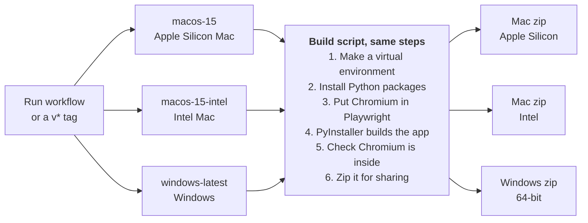

# WebSnap: Cross-Platform Build Guide

Last updated 23 November 2026

## Overview

One GitHub Actions run builds WebSnap for Apple Silicon Macs, Intel Macs and Windows, each with its own copy of Chromium inside, so users install nothing else. It exists because PyInstaller only builds for the system it runs on: a Mac cannot make a Windows app, and an Apple Silicon Mac cannot make an Intel one.

The three builds run at the same time on GitHub's machines. Each produces one zip ready to hand to users:

| Zip to share | For | GitHub artifact name | Built on |
| --- | --- | --- | --- |
| `WebSnap-macos-arm64.zip` | Apple Silicon Macs (M1 and later) | `WebSnap-macos-15` | `macos-15` |
| `WebSnap-macos-x86_64.zip` | Intel Macs | `WebSnap-macos-15-intel` | `macos-15-intel` |
| `WebSnap-windows.zip` | 64-bit Windows 10 or 11 | `WebSnap-windows-latest` | `windows-latest` |

## Files in the repository

Six files make up the project. Five sit in the top folder; the workflow must live at exactly `.github/workflows/build.yml`, or GitHub will not find it.

```
WebSnap/
├── .github/
│   └── workflows/
│       └── build.yml
├── .gitattributes
├── build_macos.sh
├── build_windows.bat
├── main.py
└── requirements.txt
```

| File | What it does |
| --- | --- |
| `main.py` | The app itself. |
| `requirements.txt` | The Python packages the app needs (PySide6, Playwright). |
| `build_macos.sh` | Builds and zips the Mac app. Used by GitHub and for local builds. |
| `build_windows.bat` | Builds and zips the Windows app. Used by GitHub and for local builds. |
| `.github/workflows/build.yml` | Tells GitHub to run the right build script on each of the three machines. |
| `.gitattributes` | Keeps Windows line endings in the `.bat` file and Unix ones in the `.sh` file; the wrong ones break each script. |

Leave these out of the repository: `.venv/`, `build/`, `dist/` and `WebSnap.spec`. The build scripts recreate all of them, so the old `WebSnap.spec` is no longer needed. To stop Git picking them up, add a `.gitignore` file containing:

```
.venv/
build/
dist/
*.spec
```

On a Mac, files starting with a dot are hidden in Finder. Press Cmd+Shift+. to show them.

## One-time setup

Put the files in a GitHub repository; Actions is switched on for new repositories, so nothing else needs enabling. A private repository works fine.

**From the Terminal** (quickest if you have Git and the GitHub CLI, `gh`):

```
cd ~/Projects/WebSnap
mkdir -p .github/workflows
mv build.yml .github/workflows/build.yml
git init
git add .
git commit -m "WebSnap with cross-platform build"
gh repo create websnap --private --source . --push
```

Without the GitHub CLI, create an empty repository on github.com, then replace the last line with:

```
git branch -M main
git remote add origin https://github.com/YOUR-NAME/websnap.git
git push -u origin main
```

**From the GitHub website** (no Terminal needed):

1. On github.com, click **New repository**, name it (for example `websnap`), choose **Private**, and create it.
2. Click **Add file → Upload files** and drag in `main.py`, `requirements.txt`, `build_macos.sh`, `build_windows.bat` and `.gitattributes`. Commit.
3. Click **Add file → Create new file**. Type the name `.github/workflows/build.yml` (each `/` makes a folder), paste in the contents of `build.yml`, and commit.

Check that `.gitattributes` uploaded: the website can skip hidden files. If it is missing, create it with **Create new file** too.

## Running a build

Start a build by hand from the Actions tab, or by pushing a version tag. Either way, all three platforms build together, and one failing does not stop the others.

**By hand:**

1. Open the repository on github.com and click the **Actions** tab.
2. Click **Build WebSnap** in the list on the left.
3. Click **Run workflow**, keep the branch as `main`, and click the green **Run workflow** button.

**With a version tag** (good for releases, as the tag records exactly which code was built):

```
git tag v1.0
git push origin v1.0
```

Any tag starting with `v` starts a build. Pushing ordinary commits does not, so editing files never uses up build minutes by accident.

Private repositories get a monthly allowance of free Actions minutes, and Mac and Windows machines use it up faster than Linux ones. Check **Settings → Billing** on your GitHub account if you build often. Public repositories build free.

## Downloading the builds

The zips appear under **Artifacts** at the bottom of the finished run's summary page.

1. In the **Actions** tab, click the run. A green tick means all three builds succeeded.
2. Scroll to **Artifacts** and click each one to download it.
3. GitHub wraps every artifact in its own zip. Unzip it once and you get the zip to share, for example `WebSnap-windows.zip`. Don't unzip that inner one; send it to users as it is.

Artifacts are deleted after 90 days by default, so keep copies of builds you hand out. To download from the Terminal instead, use `gh run download`, which asks which run you want and saves its artifacts in the current folder.

## Giving the app to users

Users unzip the right file and open the app; nothing else needs installing. Because the app is not signed, Mac and Windows both warn on first launch, and users need to approve it once.

**Mac users**

1. Pick the right zip. In **Apple menu → About This Mac**, a chip named "Apple M…" needs `WebSnap-macos-arm64.zip`; "Intel" needs `WebSnap-macos-x86_64.zip`.
2. Double-click the zip to unzip it, then drag **WebSnap.app** into **Applications**.
3. Open it. macOS will refuse because the developer is unidentified. Go to **System Settings → Privacy & Security**, scroll down, click **Open Anyway** beside the WebSnap message, and confirm. On recent macOS versions, right-click → Open no longer gets past this.
4. If macOS instead says the app "is damaged and can't be opened", run this in Terminal, then open it again:

```
xattr -cr /Applications/WebSnap.app
```

**Windows users**

1. Right-click `WebSnap-windows.zip` and choose **Extract All**. Running the app from inside the zip without extracting it does not work.
2. Open the extracted `WebSnap` folder and run **WebSnap.exe**. Keep the whole folder together: the `_internal` folder beside the exe holds Python, Qt and Chromium.
3. If Windows shows "Windows protected your PC", click **More info**, then **Run anyway**.
4. For a Start menu or desktop shortcut, right-click **WebSnap.exe → Create shortcut** and move the shortcut where you want it.

On both systems, screenshots go to a `WebSnap_Output` folder in the user's home folder unless they choose another with **Browse…**.

## How the build works

Each GitHub machine installs Python 3.13 and runs the same build script you would run locally: `build_macos.sh` on the Macs, `build_windows.bat` on Windows. GitHub then uploads the zip each one makes.



Three of the steps matter most:

- **Chromium goes inside the app (step 3).** A packaged Playwright app only looks for its browser inside its own folder, never in the user's cache. So the script installs Chromium with `PLAYWRIGHT_BROWSERS_PATH=0`, which puts it inside the Playwright package, and PyInstaller copies it into the app. `--only-shell` installs just the headless browser WebSnap uses, which is much smaller than the full browser.
- **The check (step 5).** The build fails with "Chromium was not bundled" unless the browser is where the app will look for it, so a broken build is never zipped.
- **Python 3.13.** The workflow uses 3.13 rather than the newest Python because of a clash between Python 3.15's new "lazy imports" and PySide6 and PyInstaller. `main.py` works around the clash, but 3.13 avoids it entirely.

## Building locally

The same scripts GitHub runs also work on your own machine, which is handy for a quick test. Each builds only for the machine it runs on.

| | Mac | Windows |
| --- | --- | --- |
| Needs | Python 3 (3.13 recommended; `brew install python@3.13`) | Python 3.13 from python.org, with **Add python.exe to PATH** ticked during install |
| Run, in the project folder | `bash build_macos.sh` | `build_windows.bat` (or double-click it) |
| App appears at | `dist/WebSnap.app` | `dist\WebSnap\WebSnap.exe` |
| Zip to share | `dist/WebSnap-macos-arm64.zip` (or `-x86_64` on Intel) | `dist\WebSnap-windows.zip` |

The first run takes a few minutes while it downloads packages and Chromium; later runs reuse the `.venv` folder. A successful build ends with "Chromium included". To try the app without building it, run `python main.py` inside the virtual environment.

## Troubleshooting

Most failures show their cause in the run's log: in the Actions tab, open the failed run, click the red job, and expand the step with the red cross.

| What you see | Likely cause | Fix |
| --- | --- | --- |
| A job sits on "Waiting for a runner" and never starts | GitHub has retired that machine type (the Intel Mac one is due to go in 2027) | Edit the `os:` lines in `build.yml`; see Maintenance |
| Build log ends with "ERROR: Chromium was not bundled" | A new Playwright or PyInstaller version stores the browser somewhere else | Look for the `playwright install` lines in the build step's log, then compare the path with the one the script checks; pin the previous versions in `requirements.txt` meanwhile |
| Windows build fails with odd errors such as "The system cannot find the batch label" | `build_windows.bat` lost its Windows line endings | Make sure `.gitattributes` is committed, then re-save the file with CRLF line endings |
| `pip` fails with "externally-managed-environment" (local Mac build) | An old copy of the build script that didn't use a virtual environment | Use the current `build_macos.sh` |
| A local Mac build uses Python 3.15 and PyInstaller fails | The script uses whatever `python3` is installed | Change `python3 -m venv .venv` to `python3.13 -m venv .venv`, delete the `.venv` folder, and build again |
| The app says "missing its built-in browser" | It was built by an older script that didn't bundle Chromium | Rebuild with the current scripts |
| "'lazy_import' object is not callable" | Python 3.15 lazy imports clashing with PySide6 and PyInstaller | Fixed in the current `main.py`; GitHub builds use Python 3.13, which avoids it entirely |
| Mac: "WebSnap is damaged and can't be opened" | macOS quarantine on an unsigned download | `xattr -cr /Applications/WebSnap.app` |
| Windows antivirus removes WebSnap.exe | A false alarm: PyInstaller apps are sometimes flagged | Allow it in Windows Security; signing the app stops this |
| A run's Artifacts section is empty or expired | The build failed, or the run is over 90 days old | Run the workflow again |

## Maintenance and next steps

The build needs little upkeep, but two things will change over time: package versions and GitHub's machines.

- **Package versions.** `requirements.txt` asks for "at least" versions, so each build gets the newest PySide6 and Playwright, and a new Chromium with each Playwright release. For builds that never change unexpectedly, pin exact versions, for example `PySide6==6.12.0` and `playwright==1.63.0` (the versions tested with this code).
- **Intel Mac machine.** `macos-15-intel` is GitHub's last Intel Mac machine and is supported until August 2027 ([source](https://core.trac.wordpress.org/ticket/64246)). After that, remove its line from `build.yml`; Intel Mac users would then need someone with an Intel Mac to run `build_macos.sh`.
- **Python version.** GitHub builds use Python 3.13, set in `build.yml` under `python-version`. Move up once PyInstaller and PySide6 fully support a newer Python.

Possible improvements, none needed for the build to work:

- Attach the three zips to a GitHub **Release** automatically when a `v` tag is pushed, giving users one download page.
- Sign and notarise the Mac app (needs an Apple Developer account) and sign the Windows exe (needs a code-signing certificate), which removes the security warnings.
- Make a Windows installer, so the app appears in the Start menu without a manual shortcut.
